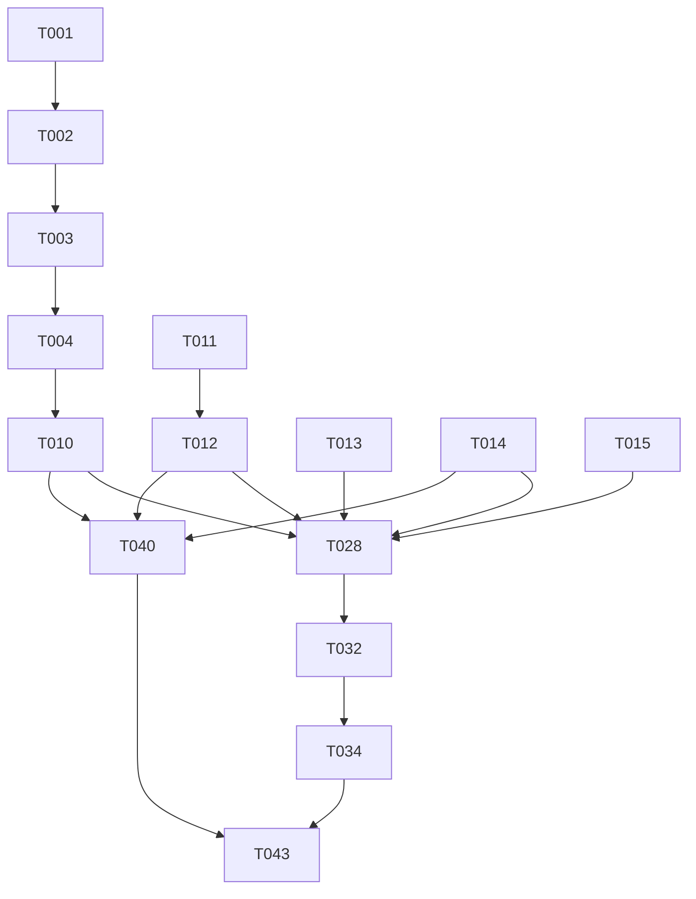

# Tasks: AI Learning Platform Foundation

**Input**: Design documents from `/specs/1-foundation/`
**Prerequisites**: plan.md, spec.md, data-model.md, contracts/openapi.yaml, research.md

## Task Summary

| User Story | Priority | Independent Test | Tasks Count |
|------------|----------|------------------|-------------|
| US1: Platform Foundation Setup | P1 | Environment starts correctly | 9 |
| US2: Authentication Foundation | P1 | End-to-end auth flow | 14 |
| US3: Profile Management | P2 | Profile CRUD operations | 8 |
| US4: Development Experience | P1 | New developer setup | 4 |

**Total Tasks**: 35
**Parallel Opportunities**: 12 tasks marked [P]

---

## Phase 1: Setup (Project Initialization)

**Goal**: Initialize the project structure and shared configuration

- [X] T001 Create project root with app/frontend and app/backend directories
- [X] T002 Initialize Next.js project with TypeScript and Tailwind CSS
- [X] T003 [P] Initialize FastAPI project with Python dependencies
- [X] T004 [P] Configure ESLint, Prettier, and TypeScript for both projects
- [X] T005 Setup docker-compose.yml for PostgreSQL in app/backend
- [X] T006 Create root .gitignore and package.json with shared scripts
- [X] T007 [P] Create root tsconfig.json with strict mode enabled
- [X] T008 [P] Create pyproject.toml and requirements.txt for backend
- [X] T009 Create README.md with project overview

---

## Phase 2: Foundational (Blocking Prerequisites)

**Goal**: Create blocking infrastructure required by all user stories

- [X] T010 Create User SQLAlchemy model in app/backend/src/models/user.py
- [X] T011 [P] Create Pydantic schemas in app/backend/src/schemas/user.py
- [X] T012 [P] Setup database engine and session in app/backend/src/core/database.py
- [X] T013 [P] Configure FastAPI dependency injection in app/backend/src/core/deps.py
- [X] T014 Create Better Auth configuration in app/backend/src/core/auth.py
- [X] T015 [P] Create API router structure in app/backend/src/api/v1/
- [X] T016 [P] Setup shadcn/ui in app/frontend/src/components/ui/
- [X] T017 [P] Create Tailwind CSS configuration in app/frontend/tailwind.config.js
- [X] T018 Create environment configuration template (.env.example)

---

## Phase 3: US1 - Platform Foundation Setup

**Goal**: Verify the development environment starts correctly and all services are accessible

**Independent Test**: Can be fully tested by verifying the development environment starts correctly and all services are accessible.

- [X] T019 [P] [US1] Create docker-compose.yml with PostgreSQL service
- [X] T020 [P] [US1] Create app/backend/Dockerfile for containerized development
- [X] T021 [P] [US1] Create startup scripts for frontend and backend
- [X] T022 [US1] Verify PostgreSQL connection in app/backend/src/core/database.py
- [X] T023 [P] [US1] Create API health check endpoint in app/backend/src/api/v1/health.py
- [X] T024 [US1] Test database migration and connection
- [X] T025 [US1] Document startup flow in quickstart.md
- [X] T026 [P] [US1] Add concurrent startup script in package.json
- [X] T027 [US1] Verify all services accessible via integration test

---

## Phase 4: US2 - Authentication Foundation

**Goal**: Enable users to register, login, and access protected routes

**Independent Test**: Can be fully tested by completing the registration and login flows end-to-end.

- [X] T028 [P] [US2] Implement register endpoint in app/backend/src/api/v1/auth/register.py
- [X] T029 [P] [US2] Implement login endpoint in app/backend/src/api/v1/auth/login.py
- [X] T030 [P] [US2] Create Better Auth callback handler in app/frontend/src/app/api/auth/[...auth]/route.ts
- [X] T031 [US2] Implement token validation middleware in app/backend/src/middleware/auth.py
- [X] T032 [P] [US2] Create registration page in app/frontend/src/app/register/page.tsx
- [X] T033 [P] [US2] Create login page in app/frontend/src/app/login/page.tsx
- [X] T034 [US2] Implement registration service with email uniqueness check
- [X] T035 [US2] Implement login service with password verification
- [X] T036 [P] [US2] Create auth context provider in app/frontend/src/contexts/auth-context.tsx
- [X] T037 [US2] Add validation for duplicate email registration
- [X] T038 [US2] Create logout functionality
- [X] T039 [US2] Test full registration → login → protected route flow

---

## Phase 5: US3 - Profile Management

**Goal**: Allow users to view and edit their profile information

**Independent Test**: Can be fully tested by creating, reading, updating, and verifying profile data.

- [X] T040 [P] [US3] Create profile GET endpoint in app/backend/src/api/v1/auth/profile.py
- [X] T041 [P] [US3] Create profile PATCH endpoint in app/backend/src/api/v1/auth/profile.py
- [X] T042 [P] [US3] Create profile page in app/frontend/src/app/profile/page.tsx
- [X] T043 [US3] Implement profile service with CRUD operations
- [X] T044 [P] [US3] Add profile form with validation in frontend
- [X] T045 [US3] Test profile update persistence
- [X] T046 [US3] Handle validation errors in UI
- [X] T047 [US3] Add email verification status to profile

---

## Phase 6: US4 - Development Experience

**Goal**: Enable smooth local development setup for new developers

**Independent Test**: Can be fully tested by a new developer setting up the project for the first time.

- [X] T048 [P] [US4] Create comprehensive README.md with setup instructions
- [X] T049 [P] [US4] Create ARCHITECTURE.md documenting decisions
- [X] T050 [US4] Create AGENTS.md with coding standards
- [X] T051 [US4] Verify setup time is under 10 minutes
- [X] T052 [US4] Add npm scripts for common development tasks
- [X] T053 [US4] Create .env.example with all required variables
- [X] T054 [US4] Test hot-reload functionality
- [X] T055 [US4] Document troubleshooting guide

---

## Phase 7: Polish & Cross-Cutting Concerns

**Goal**: Finalize quality and documentation

- [X] T056 [P] Write unit tests for User model
- [X] T057 [P] Write contract tests for auth endpoints
- [X] T058 [P] Write integration tests for auth flow
- [X] T059 Write end-to-end tests for user scenarios
- [X] T060 [P] Configure CI pipeline with quality gates
- [X] T061 Run full test suite and verify 100% pass rate
- [X] T062 Update documentation with final architecture decisions
- [X] T063 Verify all Constitution requirements met
- [X] T064 Create final quickstart.md with verified steps

---

## Dependencies & Execution Order

---

## Parallel Execution Opportunities

**Setup Phase**:
- T002, T003, T006, T007, T008 can run in parallel

**Foundational Phase**:
- T010, T011, T012, T016, T017 can run in parallel

**US1 (Platform Foundation)**:
- T019, T020, T021 can run in parallel

**US2 (Authentication)**:
- T028, T029, T030, T032, T033 can run in parallel

**US3 (Profile)**:
- T040, T041, T042 can run in parallel

---

## Implementation Strategy

**MVP Scope** (Minimum Viable Product):
1. Project structure (T001-T009)
2. Database setup (T010, T012)
3. Basic registration (T028)
4. Basic login (T029)
5. Quickstart documentation (T048)

**Incremental Delivery**:
- Phase 1: Setup + Foundational (Infrastructure ready)
- Phase 2: US1 (Environment verified)
- Phase 3: US2 (Authentication working)
- Phase 4: US3 (Profile management)
- Phase 5: US4 + Polish (Developer experience)